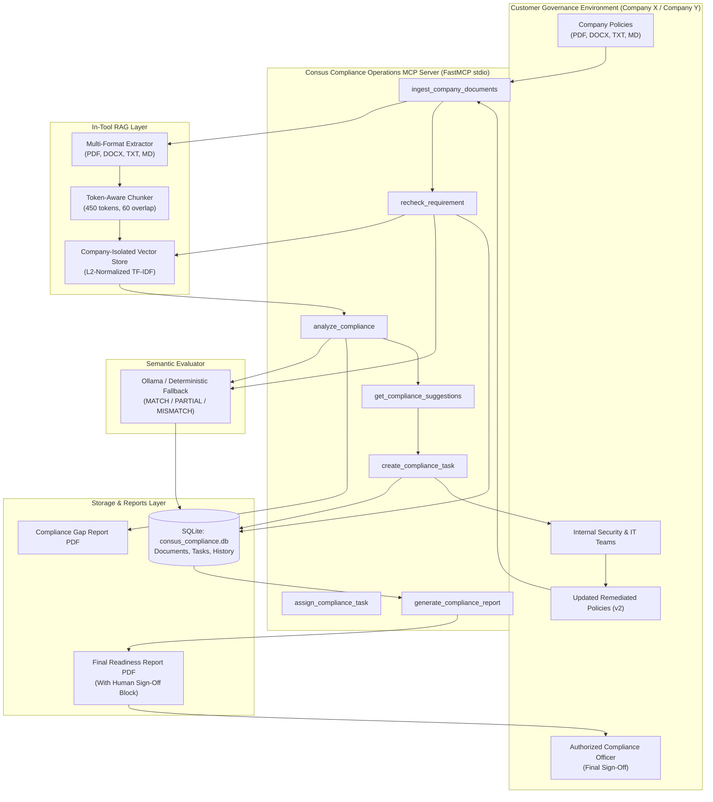

# Consus Compliance Operations MCP Platform

An enterprise-grade Model Context Protocol (MCP) server providing an automated, customer-side compliance-readiness workflow for organizations preparing to deploy sensitive aerospace and defense AI workloads on compliant infrastructure.

---

## 1. Startup Overview: Consus

**Consus** is a real Y-Combinator startup developing secure, compliant AI gateway infrastructure tailored for aerospace and defense enterprises. Its public platform architecture addresses strict federal security standards—including ITAR, FedRAMP High, and Controlled Unclassified Information (CUI)—through sovereign boundaries, US-person access restrictions, immutable auditing, and cryptographic isolation.

> **Important Boundary & Governance Clarifications:**
> - **Real Startup:** Consus (compliant AI infrastructure gateway).
> - **Our Prototype:** An independent, complementary **customer-side compliance-readiness platform**.
> - **Fictional Example Customers:** 
>   - **Company X:** Hypothethical aerospace contractor used as baseline benchmark.
>   - **Company Y:** Prospective aerospace AI contractor onboarding multi-format policies (PDF, DOCX, TXT, MD).
>   - *Neither Company X nor Company Y is an actual Consus client.*
> - **Representative Requirements:** The compliance controls in this prototype are **representative benchmarks** modeled after publicly described defense AI governance frameworks. They are **not** proprietary internal Consus documents, nor is this an official Consus platform.

---

## 2. Problem Statement

Before an aerospace or defense organization can onboard mission-critical AI workloads to a secure gateway like Consus, it must verify that its own internal policies and cloud architecture comply with stringent federal security baselines (ITAR, FedRAMP High, CMMC Level 2, NIST SP 800-171).

Currently, this compliance preparation is manual, slow, and expensive:
- **Manual Auditing Delays:** Compliance officers must cross-reference hundreds of pages of internal policies across disparate formats (PDFs, Word documents, text files) against complex regulatory control frameworks.
- **Context Window Inefficiencies:** Dumping entire corporate policy documents into LLM prompts consumes tens of thousands of tokens, increases latency, and degrades reasoning precision.
- **Multi-Tenant Data Leakage Risks:** Multi-company auditing tools risk blending policy evidence across clients.
- **Unauthorized Policy Alterations:** Automated AI tools that attempt to modify customer policies create governance liabilities. Policy authoring and final sign-off **must remain with human compliance officers**.

This MCP server solves these challenges by orchestrating a structured, multi-company, version-aware compliance discovery workflow with in-tool RAG, automated task tracking, and dual PDF reporting, while strictly preserving **human-in-the-loop authority**.

---

## 3. Why This Does NOT Copy Consus's Core Product

| Dimension | Consus Core Product | Our Complementary MCP Server |
|---|---|---|
| **Operating Domain** | Live Runtime Gateway Infrastructure | Pre-Deployment Customer-Side Governance |
| **Primary Function** | Zero-trust inference routing, live boundary isolation, enclaves | Policy auditing, gap discovery, task tracking, readiness reporting |
| **Deployment Target** | Defense cloud boundary / Kubernetes clusters | Customer internal compliance workspace (Claude Desktop / Cursor) |
| **Role in Workflow** | The compliant destination platform | The preparation assistant that makes customers ready for Consus |

---

## 4. Multi-Company Strict Isolation & Version Awareness

### Strict Multi-Tenant Isolation
The platform enforces strict tenant segregation across both SQLite and the vector database:
- **Isolated SQLite Storage:** Findings, remediation tasks, and readiness reports are partitioned by `company_id`.
- **Isolated Vector Retrieval:** The vector store maintains independent chunk collections, TF-IDF vocabularies, and embedding matrices for each company (`company_chunks[company_id]`). Queries for Company Y **never** retrieve Company X chunks, and vice versa.

### Version-Aware Policy Comparison
When human compliance teams remediate identified gaps and upload updated documents (e.g., `_v2`):
1. **Document Registry Tracking:** The database registers the new version as active (`is_active = 1`) and flags superseded versions as inactive (`is_active = 0`), preserving an immutable audit history.
2. **Dynamic Vector Replacement:** The vector store swaps superseded chunks out of the active retrieval matrix and replaces them with remediated chunks.
3. **Audit History Log:** Every evaluation and re-check is preserved in the `assessment_history` table for traceability.

---

## 5. Multi-Format Document Ingestion Engine

Organizations store policies in varied formats. The platform includes an integrated document text extraction engine (`src/rag/extractor.py`) supporting:
- **PDF Documents (`.pdf`):** Extracted page-by-page using `pypdf`, preserving section headers.
- **Word Documents (`.docx`):** Extracted paragraph-by-paragraph and table-by-table using `python-docx`, maintaining heading hierarchy.
- **Plain Text (`.txt`):** Direct stream extraction with section parsing.
- **Markdown (`.md`):** Native structure parsing with token-aware sliding window.

---

## 6. End-to-End Workflow Architecture



### Operational Workflow Stages:
1. **Trigger:** A customer decides to onboard defense AI workloads onto Consus and initiates an assessment in Claude Desktop or Cursor.
2. **Ingestion:** Policies (`.pdf`, `.docx`, `.txt`, `.md`) are parsed, chunked, and embedded into the company-isolated vector store.
3. **RAG Gap Analysis:** `analyze_compliance` queries representative Consus requirements against customer chunks and evaluates alignment (`MATCH`, `PARTIAL`, `MISMATCH`).
4. **Gap Report PDF Generation:** An automated PDF gap report is generated detailing missing controls, reasoning, and recommended actions.
5. **Actionable Suggestions:** `get_compliance_suggestions` provides sample policy clauses and remediation steps tailored to the findings.
6. **Task Routing:** `create_compliance_task` creates tracked remediation tasks for `PARTIAL` and `MISMATCH` findings and assigns them to Security, Compliance, or Infrastructure teams.
7. **Human Remediation:** Human policy leads author updated policy files (`_v2`). The AI never modifies policies directly.
8. **Updated Ingestion & Re-Check:** Remediated policies are ingested. `recheck_requirement` runs semantic evaluation against updated evidence.
9. **Automated Task Resolution:** When a requirement upgrades to `MATCH`, the associated task is automatically marked `RESOLVED`.
10. **Final Readiness Report:** When all assessed requirements match and all tasks are resolved, `generate_compliance_report` produces a comprehensive Markdown summary and a Final Readiness PDF featuring executive metrics and human governance sign-off fields.
11. **Human Sign-Off:** The authorized compliance officer executes final verification and signs the readiness certification.

---

## 7. RAG In-Tool Design & Empirical Token Savings

Rather than dumping full policy manuals into the LLM context window, retrieval occurs **inside the MCP tool**:

### Chunking Parameters:
- **Target Chunk Size:** ~450 tokens (bounds: 400–600 tokens).
- **Chunk Overlap:** ~60 tokens (bounds: 50–100 tokens).
- **Top-K Retrieval:** 3–4 chunks per requirement query.

### Empirical Token Measurements (Live Test Run):
Measurements taken using TikToken cl100k_base across the policy repository:

| Metric | Measured Value | Notes |
|---|---|---|
| **Total Full Repository Tokens** | **5,428 tokens** | Raw token count if full policies were dumped into context |
| **Top-3 Retrieved Chunks Passed to LLM** | **591 tokens** | Precise evidence chunks passed per evaluation |
| **Tokens Saved per Query** | **4,837 tokens** | Reduction in context load per requirement |
| **Context Window Reduction** | **89.11%** | Significant reduction in latency, API costs, and hallucination risk |

---

## 8. MCP Server Tools, Resources, and Prompts Catalog

The server exposes **15 operational tools**, **1 catalog resource**, and **2 guided prompts**:

### MCP Tools

| Tool Name | Parameters | Purpose & Description |
|---|---|---|
| `register_company` | `company_name: str`, `description: Optional[str]` | Registers a new company or vendor. Sets up company-isolated SQLite namespace and document folder. |
| `scan_company_documents` | `company_id: str`, `path: Optional[str]` | Discovers multi-format policy documents (.pdf, .docx, .txt, .md) automatically without requiring raw Windows paths. |
| `store_company_documents` | `company_id: str`, `path: Optional[str]` | Chunks, embeds, and indexes discovered policies into the company-isolated vector store; synchronizes active SQLite documents. |
| `ingest_company_documents` | `company_id: str`, `path: Optional[str]` | Backward-compatible alias for `store_company_documents`. |
| `analyze_compliance` | `company_id: str`, `category: Optional[str]` | Evaluates internal policies against representative Consus requirements using RAG. Returns friendly explanation cards (policy meaning, Consus requirement meaning, gap, severity). Generates Gap Report PDF. |
| `get_compliance_suggestions` | `company_id: str`, `requirement_id: Optional[str]` | Provides actionable policy clauses and remediation steps strictly for `PARTIAL` and `MISMATCH` findings. |
| `create_compliance_tasks` | `company_id: str` | Batch creates remediation tasks for all identified gaps and routes them to responsible teams (Infrastructure, Security, Compliance). |
| `create_compliance_task` | `requirement_id: str`, `finding: str`, `severity: str`, `recommended_action: str`, `company_id: str` | Single task creation tool. Strict rule: Rejects `MATCH` findings. |
| `assign_compliance_task` | `task_id: str`, `assigned_team: str` | Assigns an open remediation task to Security, Compliance, Infrastructure, or IT teams. |
| `update_task_status` | `task_id: str`, `status: str`, `notes: Optional[str]` | Manages task operational lifecycle (`OPEN`, `IN_PROGRESS`, `WAITING_FOR_EVIDENCE`, `RESOLVED`, `REJECTED`). |
| `recheck_requirement` | `company_id: str`, `requirement_id: str` | Re-evaluates a single requirement against updated evidence. Auto-resolves associated task upon reaching `MATCH`. |
| `recheck_company_compliance` | `company_id: str` | Batch re-evaluates all requirements against active updated policies and auto-resolves tasks. |
| `generate_remediation_report` | `company_id: str` | Produces a focused remediation summary of open tasks, assigned teams, problems, and actionable steps. |
| `generate_final_readiness_report` | `company_id: str` | Produces the final readiness report in Markdown and PDF with detailed requirement analysis and human sign-off block. |
| `generate_compliance_report` | `company_id: str` | Backward-compatible entry point for `generate_final_readiness_report`. |

### MCP Resources

| URI | MIME Type | Description |
|---|---|---|
| `consus://requirements` | `text/markdown` | Read-only catalog of representative Consus compliance requirements (Data Residency, IAM, Audit Logging, Encryption, Incident Response, Vulnerability, CUI). |

### MCP Prompts

| Prompt Name | Arguments | Description |
|---|---|---|
| `company_onboarding_and_readiness` | `company_name: str` | Natural conversational onboarding prompt: Scan -> Store -> Compare -> Tasks -> Remediate -> Recheck -> Final Readiness. |
| `compliance_readiness_assessment` | `company_name: str`, `company_id: str` | Structured prompt template orchestrating end-to-end technical pre-assessment workflow. |

---

## 9. Host Configuration & Comparison

The server runs on standard `stdio` transport and connects to both **Claude Desktop** and **Cursor**:

### A. Claude Desktop Setup
File location on Windows: `%APPDATA%\Claude\claude_desktop_config.json`

```json
{
  "mcpServers": {
    "consus-compliance": {
      "command": "E:\\MCP 2\\.venv\\Scripts\\python.exe",
      "args": ["-m", "src.server"],
      "cwd": "E:\\MCP 2",
      "env": {
        "PYTHONPATH": "E:\\MCP 2",
        "LLM_PROVIDER": "fallback"
      }
    }
  }
}
```

### B. Cursor Setup
File location: `E:\MCP 2\.cursor\mcp.json`

```json
{
  "mcpServers": {
    "consus-compliance": {
      "command": "E:\\MCP 2\\.venv\\Scripts\\python.exe",
      "args": ["-m", "src.server"],
      "cwd": "E:\\MCP 2",
      "env": {
        "PYTHONPATH": "E:\\MCP 2",
        "LLM_PROVIDER": "fallback"
      }
    }
  }
}
```

### Host Feature Comparison:

| Capability | Claude Desktop | Cursor (Composer / Agent) |
|---|---|---|
| **Primary Interaction** | Executive chat UI with point-wise bullet summaries | Code editor with inline agent timeline |
| **Tool Execution** | Autonomous multi-step tool chaining | Direct agent execution with local workspace context |
| **Remediation Experience** | High-level governance planning and tracking | Immediate editing of `.docx`, `.md`, or `.pdf` policy files |
| **Report Review** | Embedded Markdown rendering in chat | Inspection of generated reports in `data/reports/` |

---

## 10. Installation & Quick Start

### 1. Prerequisites
- Python 3.11+
- Virtual environment with dependencies installed:
  ```powershell
  uv pip install -r requirements.txt
  ```

### 2. Verify MCP Server Handshake
Ensure the server starts cleanly over stdio with zero stdout pollution:
```powershell
.\.venv\Scripts\python.exe scripts/test_mcp_handshake.py
```

### 3. Run the Complete Test Suite
Run all 18 automated unit and integration tests:
```powershell
.\.venv\Scripts\python.exe -m pytest tests -v
```

### 4. Run the End-to-End Demonstration
Execute the full two-company lifecycle (Company X baseline + Company Y multi-format onboarding):
```powershell
.\.venv\Scripts\python.exe scripts/run_demo.py
```

---

## 11. Dual PDF Report Outputs

Generated reports are saved in `data/reports/`:
1. **Compliance Gap Report PDF (`compliance_gap_report_{company_id}_{timestamp}.pdf`):**
   - Summary statistics (Total, MATCH, PARTIAL, MISMATCH)
   - Detailed gap analysis per requirement
   - Missing mandatory controls and actionable remediation steps
   - Pre-assessment disclaimer
2. **Final Compliance Readiness Report PDF (`final_readiness_report_{company_id}_{timestamp}.pdf`):**
   - Executive readiness status banner (`READY FOR HUMAN REVIEW`)
   - Complete requirement-by-requirement verification table
   - Remediation task resolution log
   - Formal **Human Compliance Governance Certification** sign-off block with signature lines for Compliance Officer and Defense/ITAR Security Lead.
